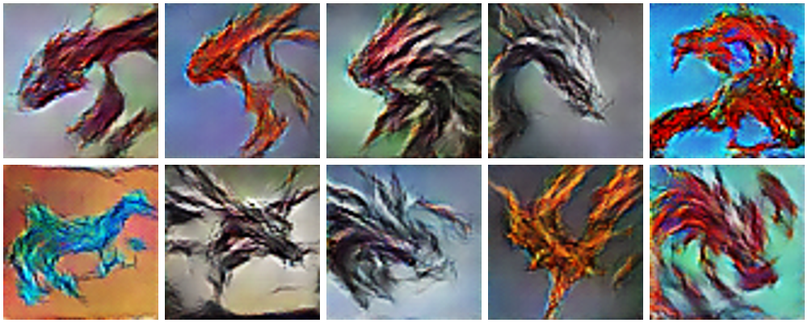

# Galería final y registro de selección

Modelo: base (pérdida no saturante), época 450. Pesos: `pesos/generator_epoch_0450.pt`.



| Id | Nombre | Clase | Candidato | Semilla | Decisión | Motivo |
|---|---|---|---|---:|---|---|
| `personaje_01.png` | Fauce Carmesí | Heraldo de guerra | `dragon_1575` | 2574 | aceptar | La cabeza de dragón más clara |
| `personaje_02.png` | Ámbar Errante | Mensajero de las dunas | `dragon_0773` | 1772 | aceptar | Cabeza, lomo y cola en una figura |
| `personaje_03.png` | Cresta Sombría | Centinela de las torres | `dragon_0630` | 1629 | aceptar | Cabeza de perfil con cresta de púas |
| `personaje_04.png` | Vela Nocturna | Exploradora de tormentas | `dragon_0718` | 1717 | reserva | Cuello y cabeza con cuernos |
| `personaje_05.png` | Brasa Celeste | Campeón de los cielos | `dragon_0224` | 1223 | aceptar | Rojo sobre azul intenso |
| `personaje_06.png` | Bruma Gris | Espectro de las cumbres | `dragon_1640` | 2639 | reserva | Único monocromo gris |
| `personaje_07.png` | Marea Azul | Guardián del río | `dragon_1583` | 2582 | reserva | Única paleta azul sobre ocre |
| `personaje_08.png` | Llama Dorada | Portadora del fuego | `dragon_1257` | 2256 | reserva | Criatura dorada con alas abiertas |
| `personaje_09.png` | Garra Sombría | Acechador nocturno | `dragon_0919` | 1918 | reserva | Figura oscura alada sobre celeste |
| `personaje_10.png` | Paso Viejo | Rastreador de los valles | `dragon_1717` | 2716 | reserva | Único cuadrúpedo en marcha |

Los nombres y clases los puso el equipo; el modelo solo genera la imagen.

## Tasa de selección

| Dato | Valor |
|---|---|
| Candidatos generados | 2 000 (semillas 1000–2999) |
| Personajes seleccionados | 10 |
| Tasa de selección | 10 ÷ 2 000 × 100 = **0,5 %** |

Criterio: `docs/criterios_evaluacion.md`. Procedimiento y resultado:
`docs/evaluacion_candidatos.md`. En una primera ronda de 200 candidatos ninguno
alcanzó "aceptar"; por eso se amplió a 2 000 con el mismo modelo.

## Contenido de `galeria/`

| Archivo | Contenido |
|---|---|
| `personaje_01.png` … `personaje_10.png` | Los diez PNG, copia exacta del candidato |
| `registro_seleccion.csv` | Identificador, candidato de origen, semilla, nombre, clase y motivo |
| `galeria_selection.json` | Semilla y vector z de cada uno, y huella del checkpoint |

## Regenerar la galería

```powershell
.\.venv\Scripts\python.exe -m dragon_gan.generate --checkpoint pesos/generator_epoch_0450.pt --output runs/galeria_regenerada --manifest galeria/galeria_selection.json
```

El comando comprueba que el checkpoint sea el declarado (SHA-256) y genera los
diez PNG desde sus vectores z.

Comprobación del 11 de octubre de 2026: los diez PNG regenerados son idénticos
byte a byte a los de `galeria/` (CPU, PyTorch 2.14.1). En otro entorno puede
haber diferencias de 1 nivel sobre 255 por píxel: así ocurrió al comparar con
los candidatos generados en Colab con PyTorch 2.11.0.

## Procedimiento seguido

```powershell
.\.venv\Scripts\python.exe -m dragon_gan.generate --checkpoint pesos/generator_epoch_0450.pt --output runs/candidates_2000 --count 2000 --seed 1000
.\.venv\Scripts\python.exe -m scripts.rank_candidates --candidates runs/candidates_2000 --sheets runs/hojas_prefiltro
.\.venv\Scripts\python.exe scripts/evaluation_table.py --candidates runs/candidates_2000
.\.venv\Scripts\python.exe scripts/evaluation_table.py --decide docs/data/evaluacion_candidatos.csv
.\.venv\Scripts\python.exe scripts/build_gallery.py --candidates runs/candidates_2000
.\.venv\Scripts\python.exe -m scripts.nearest_neighbors --generated galeria --metric cnn
```

Las notas se llenan a mano en `docs/data/evaluacion_candidatos.csv` y los diez
elegidos se escriben en `docs/data/seleccion_final.csv` (`file`, `motivo`,
`nombre`, `clase`).
