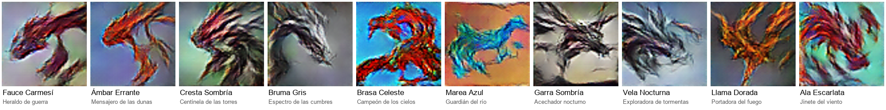
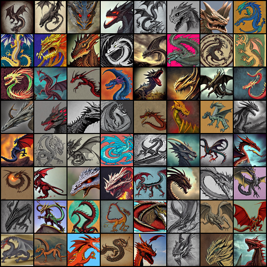
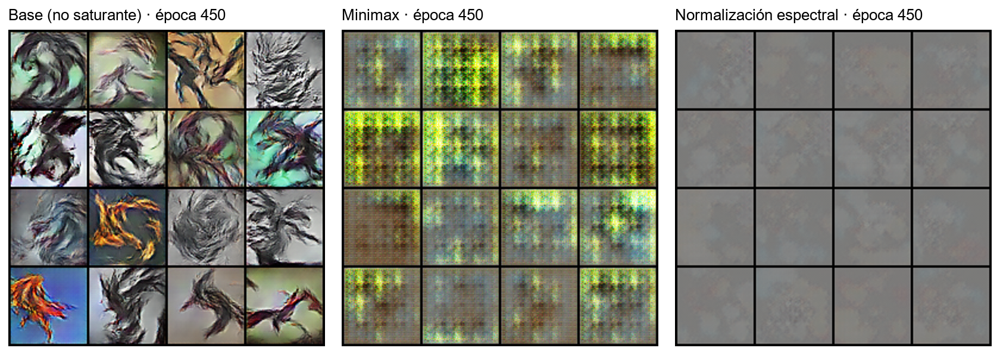
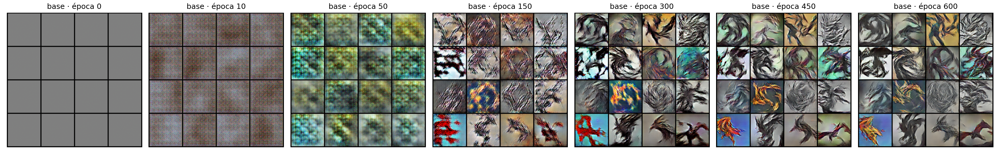
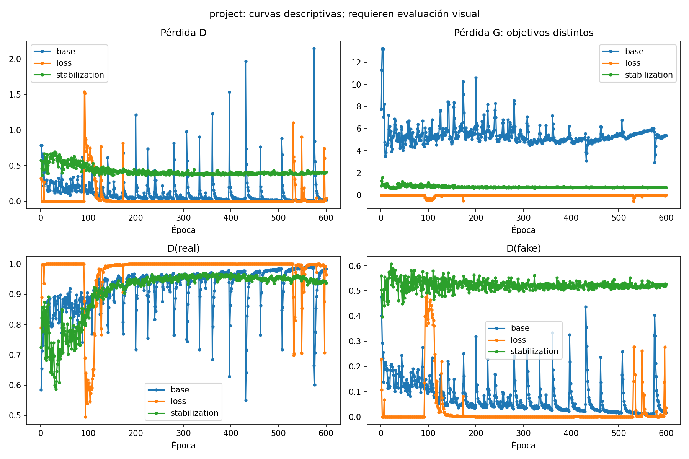
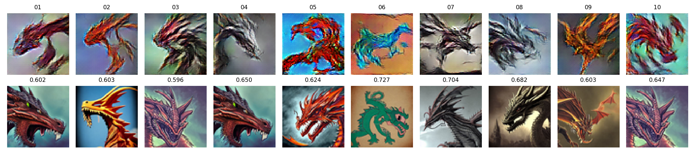
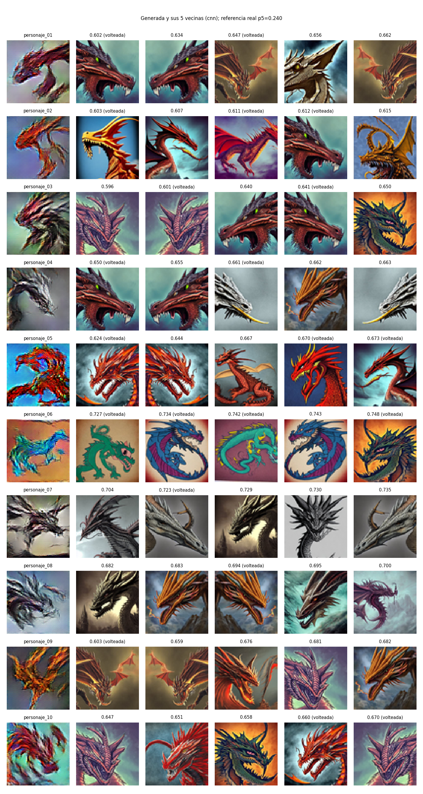
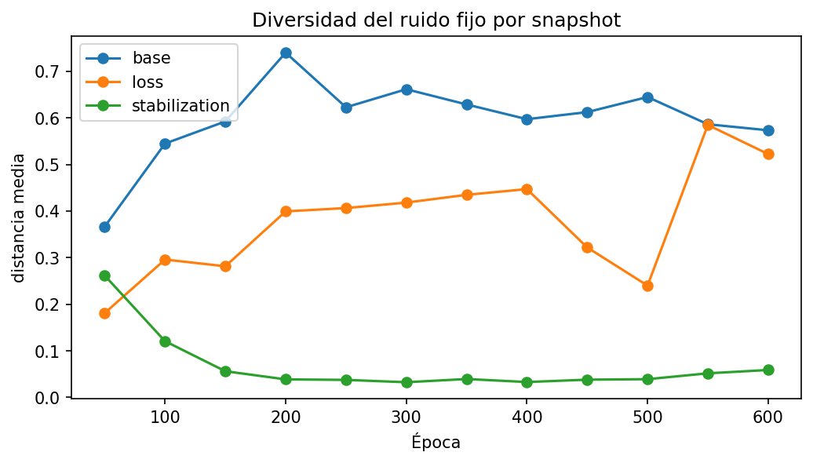

# Guion de la presentación

Fuente de `presentacion.pptx`: cada sección `##` es una diapositiva, cada viñeta
es una línea de texto, las filas con `|` forman una tabla y la imagen va a la
derecha (o abajo si es muy ancha). Generar con
`python scripts/build_presentation.py`. Máximo 12 diapositivas; lo que va
después son anexos.

## 1. Dragones de fantasía medieval con una GAN

- Proyecto 2 · Deep Learning 2026 · Universidad del Valle de Guatemala
- Daniel Estrada y Daniela Ramírez de León
- Repositorio: https://github.com/DannyEst6109/Proyecto-2---GAN---Deep-Learning
- Universo: dragones de fantasía medieval, con escamas, cuernos y alas
- Estilo: ilustración, colores terrosos y oscuros, cielos y fondos simples
- Referencia visual: Game of Thrones. Los personajes deben ser nuevos
- Vara para juzgar la galería: que se reconozca un dragón, con cabeza y cuerpo o alas, y que no repita a otro

## 2. Datos: origen, permiso y preparación

- Dino or Dragon? de agrigorev (Kaggle, versión 1). Licencia CC0
- Imágenes sintéticas de Stable Diffusion v1.4; no son fotogramas de la serie
- 965 dragones revisados: 0 archivos dañados y 0 duplicados
- 9 descartadas: 5 cartas con texto, 1 negra, 2 recortes extremos, 1 foto de un dibujo
- Versión final: 956 imágenes, misma para los tres experimentos
- Preparación: RGB, 512×512 a 64×64 con Lanczos, normalización a [-1, 1]
- Aumento: volteo horizontal aleatorio (p = 0,5)

## 3. Arquitectura: DCGAN de 64×64

- Elegida por ser la base más simple y estable para pocos datos y 64×64
- Generador: z de 100 → 4 convoluciones transpuestas con BatchNorm y ReLU → Tanh
- Canales del generador: 512, 256, 128, 64, 3 (3,6 millones de parámetros)
- Discriminador: 4 convoluciones con BatchNorm y LeakyReLU(0,2) → 1 logit (2,8 millones)
- Adam, lr 0,0002, betas (0,5; 0,999), lote 64, 600 épocas, semilla 42
- Entrenada en Colab con GPU T4: unos 15 minutos por variante
- El código regenera la galería desde los pesos y los vectores z guardados

## 4. Experimentos: hipótesis previas y control

- Un solo cambio por variante; mismos datos, semilla, épocas, z y ruido fijo
- Pérdida: no saturante (base) frente a minimax original
- Hipótesis: creemos que la no saturante mejorará el aprendizaje porque minimax da gradientes casi nulos cuando D rechaza con confianza. Útil si aparecen dragones antes o mejores, sin perder diversidad
- Estabilización: normalización espectral en D frente a BatchNorm
- Hipótesis: creemos que mejorará estabilidad y diversidad porque limita a D. Útil si D(real) y D(fake) se alejan de 1 y 0 y el ruido fijo conserva diversidad
- Hipótesis escritas antes de entrenar: docs/hypotheses/v3/

## 5. Resultados de los experimentos

- Pérdida, hipótesis confirmada: con minimax D llega a pérdida ≈ 0 en 554 de 600 épocas y G no recibe gradiente; solo produce un patrón de tablero
- Estabilización, hipótesis rechazada: D ya no domina (D(fake) ≈ 0,52) pero G colapsa en una mancha gris; la diversidad cae de 0,26 a 0,03
- Curvas equilibradas no significaron un entrenamiento sano
- La base es la única con siluetas variadas; diversidad ≈ 0,6
- Modelo elegido: base, época 450. Entre 450 y 600 ya no mejora

## 6. Evidencia 1: rejilla de ruido fijo (base)

- Los mismos 16 vectores z en las épocas 0, 10, 50, 150, 300, 450 y 600
- Época 50: solo textura. Época 150: aparecen trazos de alas y color. Época 300: siluetas
- De 450 a 600 las siluetas casi no cambian
- Las 16 posiciones siguen siendo distintas entre sí: no hay colapso en la base

## 7. Evidencia 2: curvas de pérdida interpretadas

- Base: G alta (≈ 5) y D baja con picos periódicos; D domina 268 épocas, señal de alarma, pero G sigue aprendiendo
- Minimax: D ≈ 0 y G ≈ 0 casi todo el tiempo. Es saturación, no éxito
- Norm. espectral: curvas planas y enfrentadas (D ≈ 0,40; G ≈ 0,68), pero las imágenes colapsaron
- Las pérdidas de G no son comparables entre variantes: tienen objetivos distintos
- Conclusión: la curva sola engaña; hay que mirarla junto al ruido fijo

## 8. Problemas encontrados y decisiones

- Primera selección: solo cuerpo completo, 22 imágenes
- Resultado: colapso de modos en las tres variantes; 0 de 600 candidatos aceptados
- Decisión: usar todos los dragones revisados (956), volteo y 64 canales base
- Decisión: cambiar la estabilización de ruido en D a normalización espectral
- Entrenamiento final: la normalización espectral volvió a colapsar
- Calidad: el modelo aprende color, fondo y trazos, pero no la anatomía completa
- Con 200 candidatos ninguno llegó a "dragón claro"; se amplió a 2 000

## 9. Galería: diez personajes

- 2 000 candidatos generados (semillas 1000–2999). Tasa de selección: 10 ÷ 2 000 = 0,5 %
- Primera ronda de 200: ninguno aceptado. Se amplió a 2 000 con el mismo modelo
- Se revisaron los 2 000 en hojas de contacto y se calificaron uno por uno los 72 mejores
- Resultado: 9 aceptados (dragón claro), 63 en reserva y 1 928 descartados
- Los diez: 8 aceptados y 2 de reserva, elegidos por variedad de pose y color
- Nombre y clase de cada personaje puestos por el equipo

## 10. Evidencia 3: vecinos más cercanos

- Arriba cada personaje; abajo su imagen de entrenamiento más parecida y la distancia
- Métrica: ResNet-18 preentrenada; también píxeles y forma, y contra imágenes volteadas
- Referencia: distancia entre imágenes reales (percentil 5 = 0,240)
- Los diez quedan entre 0,60 y 0,73: ninguno es copia y no hay alertas
- Los vecinos comparten paleta y fondo; un mismo dragón real es vecino de varios personajes
- Prueba del método: una copia exacta y una volteada dan distancia 0

## 11. Reflexión, conclusiones y limitaciones

- Más difícil de defender: Vela Nocturna (08). En forma queda a 0,771 de una cabeza real de perfil, casi en el umbral (0,768): misma pose y sombras, aunque otra cresta, color y fondo
- Qué aprendió la GAN: el encuadre más repetido del dataset. 4 de los 10 personajes son cabezas de perfil; lo nuevo son los detalles y el color
- La pérdida no saturante fue necesaria; la normalización espectral, tal como se aplicó, empeoró
- Los datos importaron más que la arquitectura: de 22 a 956 imágenes se pasó de colapso a variedad
- Limitaciones: solo 9 de 2 000 son dragones claros; datos sintéticos de estilos mezclados, 64×64, una sola semilla y evaluación visual subjetiva
- Estar lejos de los vecinos no prueba novedad: también refleja menor detalle

## 12. Matriz de evidencias

| Evidencia | Diap. | Conclusión | Limitación |
| Universo y datos con licencia CC0 | 1, 2 | 956 imágenes revisadas y documentadas | Datos sintéticos de Stable Diffusion |
| DCGAN y código que regenera la galería | 3 | Regenera los 10 PNG idénticos byte a byte | Igualdad exacta solo en el mismo entorno |
| Experimento de pérdida | 4, 5 | Hipótesis confirmada: minimax satura | Una sola semilla |
| Experimento de estabilización | 4, 5 | Hipótesis rechazada: colapso con norm. espectral | No se probó otra tasa para D |
| Rejilla de ruido fijo | 5, 6 | Siluetas desde la época 150; sin colapso en la base | Solo 16 vectores z |
| Curvas de pérdida | 7 | D domina en la base; curvas planas no implican calidad | No miden calidad ni novedad |
| Galería y tasa de selección | 9 | 10 de 2 000 (0,5 %): 8 aceptados y 2 de reserva | Anatomía incompleta; evaluación subjetiva |
| Vecinos más cercanos | 10 | Ninguna copia ni alerta; comparten paleta y fondo | No prueban novedad |
| Fallos y colapso de modos | 5, 8 | Colapso con 22 imágenes y con norm. espectral | Causa no aislada con experimentos |

## Anexo A. Criterios de evaluación de candidatos

- dragon: ¿se reconoce como dragón?
- cuerpo_alas: ¿se ven cuerpo y alas?
- universo: ¿encaja en fantasía medieval?
- anatomia: ¿tiene deformaciones?
- distinto: ¿se diferencia de otros candidatos?
- novedad: ¿se diferencia del entrenamiento?
- Aceptar: dragon = 2, ningún 0 y suma ≥ 9. Reserva: dragon ≥ 1, ningún 0 y suma de 7 u 8

## Anexo B. Vecinos más cercanos: detalle

- Cada fila: personaje y sus 5 vecinas más cercanas con ResNet-18
- En píxeles tampoco hay alertas: el más cercano es Llama Dorada (09), a 0,324 (umbral 0,303)

## Anexo C. Diversidad del ruido fijo por época

- Distancia media entre las 16 muestras; cerca de 0 significa colapso

## Anexo D. Uso de asistentes de IA

- Se usaron Codex y Claude Code para programar, revisar el dataset y documentar
- Detalle en README.md
- Ninguna imagen de la galería proviene de un generador externo
